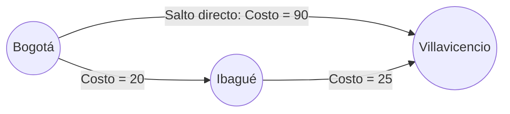

# Rutas y Conexiones de Colombia 🇨🇴
### Proyecto Integrador de Aula · Estructura de Datos (2026)

> **Metodología de Aprendizaje Basado en Problemas (ABP)**  
> *OBSERVAR · JUZGAR · ACTUAR*

---

## 1. Información General y Equipo de Trabajo

* **Materia:** Estructura de Datos
* **Fecha:** Noviembre de 2026
* **Lenguaje:** C++ (Estándar C++11 o superior)
* **Entorno:** Consola multiplataforma (Windows / Linux / macOS)
* **Integrantes del Equipo:**
  - **Jerónimo Martínez Daza** - *Desarrollo de Estructuras de Datos, Algoritmos y Pruebas*

---

## 2. Descripción del Problema y Objetivos

Una red vial conecta distintas ciudades de Colombia mediante carreteras y trayectos. En la toma de decisiones sobre transporte y logística se requiere modelar la red para responder tres interrogantes fundamentales:

1. **¿Se puede llegar? (Conectividad / Alcanzabilidad):**  
   Determinar si existe al menos una secuencia de carreteras entre una ciudad de origen y una de destino.
2. **¿Cómo explorarlas? (Recorridos ordenados):**  
   Explorar exhaustivamente la red registrando las ciudades visitadas, ya sea por niveles de cercanía o avanzando en profundidad.
3. **¿Cuál conviene? (Optimización):**  
   Encontrar la ruta que minimice el costo acumulado (distancia estimada, tiempo o peajes con pesos no negativos).

---

## 3. Modelo de Datos y Estructuras Elegidas

El problema se modela matemáticamente como un **Grafo Ponderado $G = (V, E)$**:
* **Vértices ($V$):** Ciudades de Colombia (p. ej., Bogotá, Medellín, Cali, Ibagué, Villavicencio, etc.).
* **Aristas ($E$):** Conexiones o carreteras directas entre ciudades.
* **Pesos ($w$):** Costo, tiempo o distancia asociada al trayecto (pesos no negativos $w \ge 0$).

### Estructura de Datos: Lista de Adyacencia
En C++ se implementa mediante un mapa asociativo de vectores de aristas:
```cpp
struct Arista {
    std::string destino;
    double costo;
};

std::map<std::string, std::vector<Arista>> adyacencia;
```

**Justificación técnica:**
* Frente a una **Matriz de Adyacencia** ($O(V^2)$ en memoria), la **Lista de Adyacencia** aprovecha que las redes de carreteras son **grafos dispersos** ($|E| \ll |V|^2$), requiriendo únicamente $O(V + E)$ de memoria.
* Permite agregar dinámicamente nuevas ciudades y rutas sin redimensionar matrices.

---

## 4. Algoritmos Implementados

| Algoritmo | Estructura Clave | Pregunta que Responde | Garantía de Optimalidad | Complejidad Temporal | Complejidad Espacial |
| :--- | :--- | :--- | :--- | :---: | :---: |
| **BFS** (Breadth-First Search) | Cola FIFO (`std::queue`) | ¿Cómo explorar nivel por nivel? ¿Cuál es el camino con **menos saltos**? | Óptimo en cantidad de aristas (grafos no ponderados) | $O(V + E)$ | $O(V)$ |
| **DFS** (Depth-First Search) | Pila LIFO (`std::stack`) | ¿Hasta dónde puedo avanzar explorando una rama hasta el fondo? | No asegura camino óptimo ni en saltos ni en costo | $O(V + E)$ | $O(V)$ |
| **Dijkstra** | Cola de Prioridad / Min-Heap (`std::priority_queue`) | ¿Cuál es la ruta con la **menor suma de costos**? | Óptimo con costos no negativos ($w \ge 0$) | $O((V + E) \log V)$ | $O(V)$ |

---

## 5. El Dilema Fundamental: "Menos Saltos $\ne$ Menor Costo"

Un aspecto central del proyecto (destacado en la diapositiva 05 del taller) es comprender por qué **BFS y Dijkstra resuelven problemas distintos**:



* **Resultado con BFS (Mínimos saltos):**  
  Ruta: `Bogotá -> Villavicencio`  
  Saltos: **1 salto**  
  Costo total: **90**
* **Resultado con Dijkstra (Costo mínimo):**  
  Ruta: `Bogotá -> Ibagué -> Villavicencio`  
  Saltos: **2 saltos**  
  Costo total: $20 + 25 =$ **45**

**Conclusión:**  
* BFS optimiza la cantidad de bordes atravesados, asumiendo que todas las aristas tienen el mismo peso.
* Dijkstra considera el peso real acumulado. Por ello, una ruta con más tramos intermedios puede ser significativamente más económica que un trayecto directo.

---

## 6. Funcionalidades del Menú de Consola

Al ejecutar el programa se presenta el menú interactivo con validación de entradas:

```text
======= SISTEMA DE RUTAS =======
1. Mostrar ciudades y conexiones (Lista de Adyacencia)
2. Recorrido BFS (Búsqueda en Anchura / Exploración)
3. Recorrido DFS (Búsqueda en Profundidad)
4. Ruta de costo mínimo (Dijkstra)
5. Consultar si existe una ruta (Alcanzabilidad)
6. Comparar BFS vs Dijkstra (Demostración Diapositiva 05)
7. Agregar nueva conexión / ciudad a la red
0. Salir
Seleccione una opción: _
```

### Casos de Prueba y Casos Límite Soportados
1. **Red estándar:** Más de 9 ciudades principales interconectadas de Colombia (Bogotá, Medellín, Cali, Ibagué, Pereira, Manizales, Bucaramanga, Barranquilla, Villavicencio).
2. **Ciudades desconectadas / Islas:** Cartagena y Santa Marta están configuradas en una componente aislada, permitiendo verificar que la opción 5 y Dijkstra reporten apropiadamente *"No existe ruta disponible"* cuando no hay camino.
3. **Validación de errores:** Ciudades inexistentes o mal digitadas, costos negativos rechazados, y cadenas vacías.
4. **Carga desde archivo:** Soporta archivo `rutas.csv` en formato `origen,destino,costo`.

---

## 7. Instrucciones de Compilación y Ejecución

### Requisitos
* Compilador C++ compatible con C++11 o superior (`g++`, `clang++`, o MSVC en Visual Studio).

### Compilación con GCC / G++ (MinGW o Linux):
```bash
g++ -std=c++17 -Wall main.cpp -o rutas_colombia
./rutas_colombia
```

### Compilación en Windows (PowerShell / CMD):
```powershell
g++ -std=c++17 main.cpp -o rutas_colombia.exe
.\rutas_colombia.exe
```

### Compilación con Clang:
```bash
clang++ -std=c++17 main.cpp -o rutas_colombia
./rutas_colombia
```

---

## 8. Preguntas Clave para la Sustentación (10 pts de Rúbrica)

1. **¿Por qué usarías BFS en un caso y Dijkstra en otro?**  
   * **BFS** se utiliza cuando todos los tramos tienen el mismo costo (o cuando el objetivo es minimizar escalas / saltos, por ejemplo en vuelos directos sin importar la distancia).
   * **Dijkstra** se utiliza cuando los tramos tienen pesos heterogéneos no negativos y el objetivo es minimizar el costo acumulado (combustible, peajes, kilómetros).

2. **¿Qué sucede si una arista tiene un costo negativo en Dijkstra?**  
   Dijkstra es un algoritmo voraz (*greedy*) que asume que una vez un nodo es extraído del heap con su menor distancia estimada, su costo óptimo no puede reducirse más. Si existen aristas negativas, esta premisa se rompe y puede dar resultados erróneos o caer en ciclos infinitos; para aristas negativas se requeriría el algoritmo de **Bellman-Ford**.

3. **¿Cuál es la diferencia en el orden de exploración entre BFS y DFS?**  
   * BFS utiliza una **cola FIFO** y explora en "anillos concéntricos" (todos los vecinos directos a distancia 1, luego distancia 2, etc.).
   * DFS utiliza una **pila LIFO** o recursión y se adentra hasta el fondo de un camino antes de retroceder (*backtracking*).

---

## 9. Registro de Commits y Etapas del Proyecto

* **Commit 1:** `chore: estructura inicial del proyecto, README y configuración de gitignore`
* **Commit 2:** `feat: implementación del modelo de grafo con lista de adyacencia y menú base`
* **Commit 3:** `feat: integración de algoritmos de exploración BFS y DFS con validación de alcanzabilidad`
* **Commit 4:** `feat: implementación de algoritmo de Dijkstra con cola de prioridad y comparativa educativa`
* **Commit 5:** `test: casos de prueba controlados, soporte para rutas.csv y manejo de grafos desconectados`
