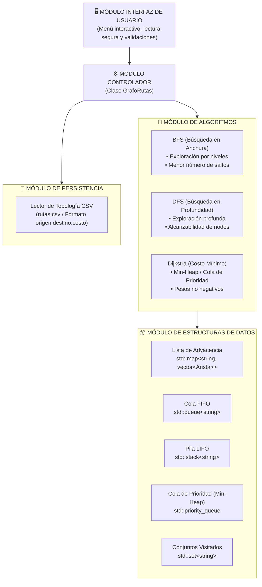

# Rutas y Conexiones de Colombia 🇨🇴
### Proyecto Integrador de Aula · Estructura de Datos (2026)

> **Metodología de Aprendizaje Basado en Problemas (ABP)**  
> *OBSERVAR · JUZGAR · ACTUAR*

---

## 1. Información General y Equipo de Trabajo

* **Materia:** Estructura de Datos
* **Fecha de Entrega:** Noviembre de 2026
* **Lenguaje:** C++ (Estándar C++17)
* **Entorno:** Consola multiplataforma (Windows / Linux / macOS)
* **Integrantes del Equipo:**
  - **Jerónimo Martínez Daza** - *Responsable de Modelado de Grafos, Algoritmos (BFS/DFS/Dijkstra), Pruebas y Documentación*

---

## 2. Estructura del Repositorio

El proyecto cumple con la organización en carpetas requerida para la entrega:

```text
rutas-colombia/
├── src/
│   └── main.cpp           # Código fuente modular en C++
├── .gitignore             # Exclusión de ejecutables y temporales de compilación
├── README.md              # Documentación técnica, diagramas, pruebas y sustentación
├── rutas.csv              # Topología de la red vial nacional (vértices, aristas, costos)
└── rutas_colombia.exe     # Archivo binario ejecutable
```

---

## 3. Diagrama Modular del Sistema

El software sigue una arquitectura modular en capas desacopladas:



---

## 4. Tabla de Estructuras de Datos

| Operación del Sistema | Estructura Usada en C++ | Justificación Técnica de la Elección | Complejidad |
| :--- | :--- | :--- | :---: |
| **Almacenamiento de la Red (Vértices y Aristas)** | `std::map<std::string, std::vector<Arista>>` (Lista de Adyacencia) | Las redes viales son **grafos dispersos** ($|E| \ll |V|^2$). La lista de adyacencia optimiza la memoria a $O(V + E)$ en lugar de $O(V^2)$ de una matriz. El `std::map` mantiene las ciudades ordenadas alfabéticamente para una visualización clara. | **Espacio:** $O(V + E)$<br>**Búsqueda:** $O(\log V)$ |
| **Recorrido en Anchura (BFS)** | `std::queue<std::string>` (Cola FIFO) | Garantiza la exploración ordenada en "anillos concéntricos" nivel a nivel, permitiendo hallar el camino con el **menor número de aristas/saltos**. | **Tiempo:** $O(V + E)$<br>**Espacio:** $O(V)$ |
| **Recorrido en Profundidad (DFS)** | `std::stack<std::string>` (Pila LIFO) | Permite profundizar de forma exhaustiva por una rama vial hasta un nodo hoja o ciclo antes de realizar retroceso (*backtracking*). | **Tiempo:** $O(V + E)$<br>**Espacio:** $O(V)$ |
| **Control de Nodos Visitados** | `std::set<std::string>` (Árbol Rojo-Negro) | Evita ciclos infinitos en el grafo y duplicados al procesar ciudades con búsqueda e inserción balanceada en tiempo logarítmico. | **Inserción:** $O(\log V)$<br>**Búsqueda:** $O(\log V)$ |
| **Optimización de Costo Mínimo (Dijkstra)** | `std::priority_queue<Par, vector<Par>, greater<Par>>` (Min-Heap) | Permite extraer siempre en $O(\log V)$ el nodo con la menor distancia acumulada provisional, reduciendo drásticamente la complejidad frente a una búsqueda lineal $O(V)$. | **Tiempo:** $O((V + E) \log V)$<br>**Espacio:** $O(V)$ |
| **Reconstrucción del Camino Óptimo** | `std::map<std::string, std::string>` (Mapa de Predecesores) | Permite rastrear la ruta óptima desde el destino hacia el origen en tiempo proporcional a los saltos de la ruta ($O(\text{saltos})$). | **Espacio:** $O(V)$ |

---

## 5. Instrucciones de Compilación y Ejecución

### Requisitos
* Compilador de C++ con soporte C++17 (GCC / g++, Clang, o MSVC).

### Compilación desde la raíz del proyecto:
```powershell
g++ -std=c++17 src/main.cpp -o rutas_colombia.exe
```

### Ejecución:
```powershell
.\rutas_colombia.exe
```

---

## 6. Registro de Ejecución de Pruebas (Evidencias de Casos Controlados)

Se ejecutaron pruebas exhaustivas que incluyen caminos exitosos, demostración conceptual y **dos entradas inválidas obligatorias**:

### ✅ PRUEBA 1: Ruta de Costo Mínimo (Dijkstra) — Válida
* **Objetivo:** Encontrar la ruta más económica entre dos ciudades del interior.
* **Entrada:** Opción `4` $\rightarrow$ Origen: `Bogota`, Destino: `Cali`.
* **Registro de Salida:**
```text
=======================================================
  RUTA ÓPTIMA ENCONTRADA:
  Bogota  ──>  Cali
-------------------------------------------------------
  Cantidad de tramos (aristas): 1
  Costo total acumulado:        60.00 unidades
=======================================================
```

---

### ✅ PRUEBA 2: Demostración Diapositiva 05 ("Menos Saltos $\ne$ Menor Costo") — Válida
* **Objetivo:** Demostrar que el camino con menos aristas (BFS) no siempre es el más económico (Dijkstra).
* **Entrada:** Opción `6` $\rightarrow$ Origen: `Bogota`, Destino: `Villavicencio`.
* **Registro de Salida:**
```text
=======================================================
  COMPARACIÓN CONCEPTUAL: MENOS SALTOS vs MENOR COSTO   
  Origen: Bogota  --->  Destino: Villavicencio
=======================================================

 [1] RESULTADO POR BFS (Menor cantidad de saltos / aristas):
     Ruta: Bogota -> Villavicencio
     Saltos (aristas): 1
     Costo total:      90.0

 [2] RESULTADO POR DIJKSTRA (Menor suma ponderada de pesos):
     Ruta óptima: Bogota -> Ibague -> Villavicencio
     Saltos (aristas): 2
     Costo total:      45.0

 [3] CONCLUSIÓN TEÓRICA:
     ¡Se comprueba la premisa: 'Menos saltos != Menor costo'!
     BFS eligió un trayecto con 1 salto(s) pero costo 90.0.
     Dijkstra encontró una ruta más económica con costo 45.0 utilizando 2 saltos.
=======================================================
```

---

### ❌ PRUEBA 3: Entrada Inválida 1 — Ciudad Inexistente en la Red
* **Objetivo:** Verificar la robustez del sistema ante nombres mal digitados o ciudades inexistentes.
* **Entrada:** Opción `4` $\rightarrow$ Origen: `Bogota`, Destino: `Wakanda`.
* **Registro de Salida:**
```text
Ingrese la ciudad de ORIGEN: Bogota
Ingrese la ciudad de DESTINO: Wakanda

 [Error] Verifique los nombres: una o ambas ciudades no existen.
Presione ENTER para continuar...
```

---

### ❌ PRUEBA 4: Entrada Inválida 2 — Opción Fuera de Rango o No Numérica
* **Objetivo:** Verificar que el menú principal rechace opciones no válidas sin colapsar el programa.
* **Entrada:** `Seleccione una opción: 99` (o texto `abc`).
* **Registro de Salida:**
```text
Seleccione una opción: 99

 [Opción inválida] Por favor ingrese un número del menú.
Presione ENTER para continuar...
```

---

### ⚠️ PRUEBA 5 (Bonus): Manejo de Componentes Desconectadas (Grafos Aislados)
* **Objetivo:** Consultar ruta entre dos ciudades que pertenecen a islas desconectadas.
* **Entrada:** Opción `4` $\rightarrow$ Origen: `Bogota`, Destino: `Cartagena`.
* **Registro de Salida:**
```text
 [Resultado] NO EXISTE NINGUNA RUTA viable entre Bogota y Cartagena.
 (Las ciudades pertenecen a componentes desconectadas del grafo).
```

---

## 7. Lista de Funcionalidades: Terminadas vs. Pendientes

| # | Funcionalidad | Estado | Responsable | Observaciones / Entrega |
| :-: | :--- | :---: | :---: | :--- |
| **1** | Modelado de grafo con Lista de Adyacencia | **Terminado (100%)** | Jerónimo Martínez Daza | Estructura dinámica en C++ con vértices y aristas ponderadas. |
| **2** | Recorrido BFS (Anchura) y cálculo de menos saltos | **Terminado (100%)** | Jerónimo Martínez Daza | Implementado con `std::queue` y detección de visitados. |
| **3** | Recorrido DFS (Profundidad) | **Terminado (100%)** | Jerónimo Martínez Daza | Implementado con `std::stack` para exploración exhaustiva. |
| **4** | Algoritmo de Dijkstra para rutas de costo mínimo | **Terminado (100%)** | Jerónimo Martínez Daza | Optimizado con Min-Heap (`std::priority_queue`). |
| **5** | Consulta de alcanzabilidad (¿Se puede llegar?) | **Terminado (100%)** | Jerónimo Martínez Daza | Responde con validación booleana clara en $O(V + E)$. |
| **6** | Demostración comparativa (Diapositiva 05) | **Terminado (100%)** | Jerónimo Martínez Daza | Caso Bogotá - Villavicencio con análisis automatizado. |
| **7** | Inserción dinámica de nuevas ciudades y conexiones | **Terminado (100%)** | Jerónimo Martínez Daza | Permite enriquecer el grafo en tiempo de ejecución. |
| **8** | Carga automática de topología desde archivo CSV | **Terminado (100%)** | Jerónimo Martínez Daza | Lee `rutas.csv` al iniciar la aplicación. |
| **9** | Manejo de entradas inválidas y errores de usuario | **Terminado (100%)** | Jerónimo Martínez Daza | Validaciones contra cadenas vacías, costos negativos y ciudades inexistentes. |
| **10** | Exportación visual a formato gráfico (Graphviz / DOT) | **Pendiente (Etapa 2)** | Jerónimo Martínez Daza | Programado para la entrega final del proyecto. |
| **11** | Búsqueda por autocompletado de ciudades | **Pendiente (Etapa 2)** | Jerónimo Martínez Daza | Mejora opcional para la sustentación. |

---

## 8. Sustentación Teórica: Preguntas Clave del Docente

1. **¿Por qué usarías BFS en un caso y Dijkstra en otro?**  
   * **BFS** es óptimo cuando todas las aristas tienen el mismo peso (o no tienen peso), minimizando el **número de saltos o transferencias**.
   * **Dijkstra** es el algoritmo adecuado cuando las conexiones tienen **pesos no negativos heterogéneos** (tiempo, distancia, costo de peajes), minimizando la suma total acumulada.
2. **¿Por qué Dijkstra no soporta pesos negativos?**  
   * Porque Dijkstra asume con criterio voraz (*greedy*) que una vez un nodo es extraído del heap con su menor costo provisional, su distancia definitiva está resuelta. Una arista negativa posterior violaría esta premisa. Para aristas negativas se debe emplear **Bellman-Ford**.
